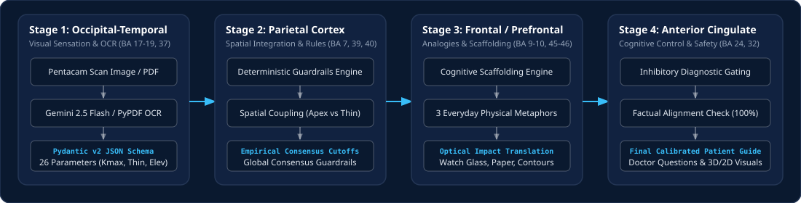

# PentaRead • Corneal Tomography (Pentacam) Cognitive Scaffolding System

[](https://www.python.org/)
[](https://ai.google.dev/)
[](https://docs.pydantic.dev/)
[](https://streamlit.io/)
**PentaRead** is an intelligent, multi-stage cognitive scaffolding system that translates complex Scheimpflug corneal tomography (**Oculus Pentacam**) scans into clear, calibrated, and anxiety-free explanations for lay patients. 

Engineered with a solid **Navy Blue and White** interface, interactive **3D and 2D eye maps**, everyday physical metaphors, and personalized doctor consultation guides.

---

## 🌟 Key Application Features

1. **Clean Frontpage Navigation (SPA Router):**
   - **Upload Your Penta Scan:** Ingest Pentacam 4-Maps Refractive, BAD-III, or Topometric image printouts or multi-page PDF reports.
   - **Paste the File Path:** Directly load local scans from disk with real-time file validation.
   - **Scan a Demo Report:** Instant access to 6 authentic clinical cases (Healthy Normal, Subclinical / Forme Fruste, Advanced Keratoconus, Post-Refractive LASIK, and Asymmetric Bilateral eyes).

2. **Personalized Patient Greeting:**
   - Auto-extracts patient name from scan headers (e.g., *"Hey Sarah! 👋"*).
   - Graceful fallback (*"Hey User! 👋"*) with an inline edit tool to customize names on the fly.

3. **Key Diagnostic Metrics Bar:**
   - Real-time evaluation of Peak Curvature ($K_{max}$), Thinnest Point Pachymetry, Posterior Elevation (BFS), and the Belin-Ambrósio ($BAD\text{-}D$) Index.
   - Evaluated deterministically against empirical cutoffs from the *Global Consensus on Keratoconus and Ectatic Diseases*.

4. **Three Interactive Physical Metaphor Popups (`@st.dialog`):**
   - ⌚ **The Watch Glass Window:** Explains corneal curvature, symmetry, and steepness.
   - 📑 **The Stack of Microscopic Paper Sheets:** Explains pachymetric thickness ($1\ \mu\text{m} = 1/1,000\text{th mm}$; healthy cornea $\approx 540\ \mu\text{m}$).
   - ⛰️ **The Mountain Contour Slope:** Explains posterior back-surface elevation using contour lines (peaks vs valleys).

5. **Dynamic 3D & 2D Models for Each Diagnostic Metric:**
   - Dedicated interactive 3D surface meshes and 2D heatmaps tailored for **Curvature ($K_{max}$)**, **Corneal Thickness**, **Posterior Elevation**, and **$BAD\text{-}D$**.
   - **Healthy Reference Comparison Toggle:** Instantly compare the patient's individual scan against a normative healthy eye model.

6. **Dynamic LLM Patient Issues Explanation:**
   - Powered dynamically by Google Gemini (`gemini-2.5-flash`).
   - Executive overview, structured anatomical breakdown, optical vision impact analysis, and tailored doctor consultation questions.

7. **Navy Blue & White Theme:**
   - Solid Deep Navy Blue canvas (`#0A192F`) and card containers (`#112240`) paired with crisp white typography and high-contrast solid white buttons (zero distracting color gradients).

---

## 🧠 Theoretical Foundation: P-FIT (Jung & Haier, 2007)

General human intelligence relies on the **Parieto-Frontal Integration Theory (P-FIT)**. Lay patients lack domain-specific parietal schemas to synthesize multi-parametric corneal geometry (color-coded curvature maps, pachymetry distributions, and elevation profiles), leading to severe prefrontal cognitive overload and anxiety when receiving complex diagnostic printouts.

This system acts as an **externalized cognitive prosthesis** implementing P-FIT across 4 strictly decoupled stages:



<details>
<summary><b>Click to view Mermaid Diagram Source</b></summary>


</details>

---

## 🔬 The 4-Stage Architecture

### 1. Stage 1: Occipital-Temporal Proxy (Visual Feature Extraction & OCR)
- **Biological Role (Brodmann Areas 17, 18, 19, 37):** Visual sensation, edge detection, tokenization, and optical character recognition.
- **Pipeline Implementation:** Multimodal ingestion of Pentacam 4-Maps Refractive, BAD-III Displays, and Topometric scans via Gemini Multimodal Vision (`gemini-2.5-flash`) and PyPDF text streams into strictly typed Pydantic v2 data contracts.
- **Extracted Indices:**
  - **Metadata:** Patient name, examined eye (OD/OS), exam date, scan quality, device model.
  - **Keratometry:** $K_1$, $K_2$, $K_m$, $K_{max}$, Astigmatism, Axis, $Q$-value asphericity, $R_{min}$.
  - **Pachymetry:** Central thickness (CCT), Thinnest Point ($\mu\text{m}$), Thinnest point $(X, Y)$ displacement (mm), $PPI_{avg/max}$, $ART_{max}$.
  - **Elevation:** Anterior and Posterior elevation at thinnest point relative to BFS/BFTE ($\mu\text{m}$), Enhanced elevation diff.
  - **Belin-Ambrósio Display:** $D_f, D_b, D_t, D_a, D_p$, and Final $BAD\text{-}D$ standard deviation index.
  - **Topometric:** $ISV, IVA, KI, CKI, IHD$.

### 2. Stage 2: Parietal Cortex Proxy (Structural Abstraction & Deterministic Guardrails)
- **Biological Role (Brodmann Areas 7, 39, 40):** Cross-modal integration, spatial manipulation, and geometric mental modeling.
- **Pipeline Implementation:** Combines spatial co-localization (verifying if the thinnest pachymetric point aligns with peak elevation protrusion) with **pure Python deterministic boundary checks** against clinical cutoffs from the *Global Consensus on Keratoconus and Ectatic Diseases*.
- **Empirical Boundary Rules:**
  - $K_{max} > 48.5\text{ D}$ $\rightarrow$ Abnormal / Focal Cone.
  - $\text{Thinnest Pachymetry} < 470\ \mu\text{m}$ $\rightarrow$ Abnormal Thinning.
  - $\text{Posterior Elevation} \ge +16.0\ \mu\text{m}$ $\rightarrow$ Pathological Posterior Protrusion.
  - $BAD\text{-}D \ge 2.60\text{ SD}$ $\rightarrow$ Pathological Red Zone.

### 3. Stage 3: Frontal / Prefrontal Proxy (Cognitive Scaffolding & Analogies)
- **Biological Role (Brodmann Areas 9, 10, 45, 46):** Hypothesis formation, working memory reduction, and analogical reasoning.
- **Pipeline Implementation:** Bridges 3D Scheimpflug tomography into everyday physical models:
  - ⌚ **The Watch Glass Window** (Curvature steepness & light refraction)
  - 📑 **The Stack of Microscopic Paper Sheets** (Pachymetric thickness & thinning)
  - ⛰️ **Topographic Elevation Contours** (Back surface elevation relative to Best Fit Sphere)
  - 👓 **Optical Impact Translation** (Astigmatism, light scatter, ghosting, lens options)

### 4. Stage 4: Anterior Cingulate Cortex / ACC Proxy (Cognitive Control & Gating)
- **Biological Role (Brodmann Areas 24, 32):** Conflict detection, error correction, inhibitory control, and goal alignment.
- **Pipeline Implementation:**
  - 🚫 **Inhibitory Gating:** Suppresses definitive diagnostic assertions (e.g., replaces *"You have Keratoconus"* with *"The scan shows localized steepening and thinning patterns evaluated by cornea specialists"*).
  - 🛡️ **Anxiety-Reduction Softening:** Replaces catastrophizing scarewords (*"severe disease", "corneal failure"*) with calm physiological descriptors.
  - ✅ **Factual Alignment Verification:** Deterministic token verification comparing numbers cited in text against Stage 1 ground truth.
  - 🩺 **Doctor Consultation Q&A Generator:** Formulates personalized, empowering questions for the patient's next clinical visit.

---

## 🚀 Quick Start

### 1. Environment Setup (Python 3.11+)
Managed via `uv`:
```bash
# Clone and enter directory
cd "Course Project"

# Install dependencies into virtualenv
uv add google-genai pydantic streamlit pillow pypdf python-dotenv plotly
```

### 2. Configuration
Create `.env` and add your Google Gemini API Key:
```bash
cp .env.example .env
```
In `.env`:
```env
GEMINI_API_KEY="your-gemini-api-key-here"
GEMINI_MODEL="gemini-2.5-flash"
GEMINI_FAST_MODEL="gemini-2.5-flash"
```

### 3. Run Unit Tests
```bash
uv run python tests/run_all_tests.py
```

### 4. Launch Streamlit Web Application

**In PowerShell / Windows:**
```powershell
.\.venv\Scripts\python.exe -m streamlit run app.py
```
*Or via `uv`:*
```powershell
uv run python -m streamlit run app.py
```

**In Bash / Linux / macOS:**
```bash
./.venv/Scripts/python -m streamlit run app.py
```

> [!TIP]
> The app opens in your browser at `http://localhost:8501`.
> To view the **P-FIT Developer Architecture Inspector & Guardrails Simulator**, append `?dev=true` to the URL:
> `http://localhost:8501/?dev=true`

---

## 📦 Project Structure

```
Course Project/
├── pyproject.toml              # uv project dependencies
├── .env.example                # Environment variables template
├── README.md                   # Comprehensive user & project documentation
├── architecture.md             # In-depth system & cognitive architecture specification
├── app.py                      # PentaRead Streamlit Web Application (Navy & White UI)
├── src/
│   ├── config.py               # Global settings (gemini-3.6-flash), models, and constants
│   ├── schemas/                # Pydantic v2 strictly-typed data contracts
│   │   ├── stage1_extraction.py# Stage 1: Pentacam OCR & metric extraction (patient name, etc.)
│   │   ├── stage2_parietal.py  # Stage 2: Parietal integration & evaluations
│   │   ├── stage3_frontal.py   # Stage 3: Frontal scaffolding & analogies
│   │   ├── stage4_acc.py       # Stage 4: ACC gating, audit & doctor Q&A
│   │   └── pipeline_state.py   # Unified pipeline state container
│   ├── guardrails/             # Deterministic clinical boundary engine
│   │   ├── clinical_cutoffs.py # Empirical thresholds (BAD-D, Kmax, Pachy, Elev)
│   │   └── deterministic_engine.py # Pure Python rule-based evaluator
│   ├── pipeline/               # Multi-stage P-FIT execution modules
│   │   ├── stage1_occipital.py # Multimodal vision OCR (gemini-3.6-flash)
│   │   ├── stage2_parietal.py  # Spatial integration & guardrails
│   │   ├── stage3_frontal.py   # Analogical scaffolding & translation
│   │   ├── stage4_acc.py       # Inhibitory gating & report assembly
│   │   ├── pdf_parser.py       # Deterministic PDF text stream parser
│   │   └── orchestrator.py     # End-to-end multi-eye pipeline executor
│   ├── visualization/          # Plotly 3D & 2D interactive corneal maps
│   │   └── corneal_maps.py     # Solid navy 3D & 2D maps for Curvature, Thickness, Elev, BAD-D
│   └── mock_data/              # High-fidelity realistic clinical cases
│       └── sample_cases.py     # Normal, Forme Fruste, Keratoconus, Post-LASIK, Bilateral
└── tests/
    ├── test_guardrails.py      # Unit tests for deterministic boundary logic
    ├── test_schemas.py         # Unit tests for Pydantic v2 schemas
    ├── test_pdf_parser.py      # Unit tests for PDF parser
    ├── test_bilateral_flow.py  # Unit tests for multi-eye comparison flow
    └── run_all_tests.py        # Unified test runner
```

---

## 🛡️ Medical Disclaimer
This cognitive scaffolding system is an educational and communication prosthesis designed to improve patient comprehension and shared decision-making. It does not provide clinical diagnoses or replace evaluation by a licensed ophthalmologist or cornea specialist.
