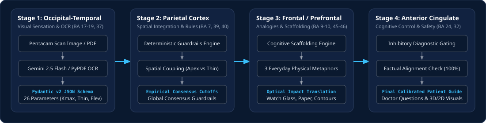
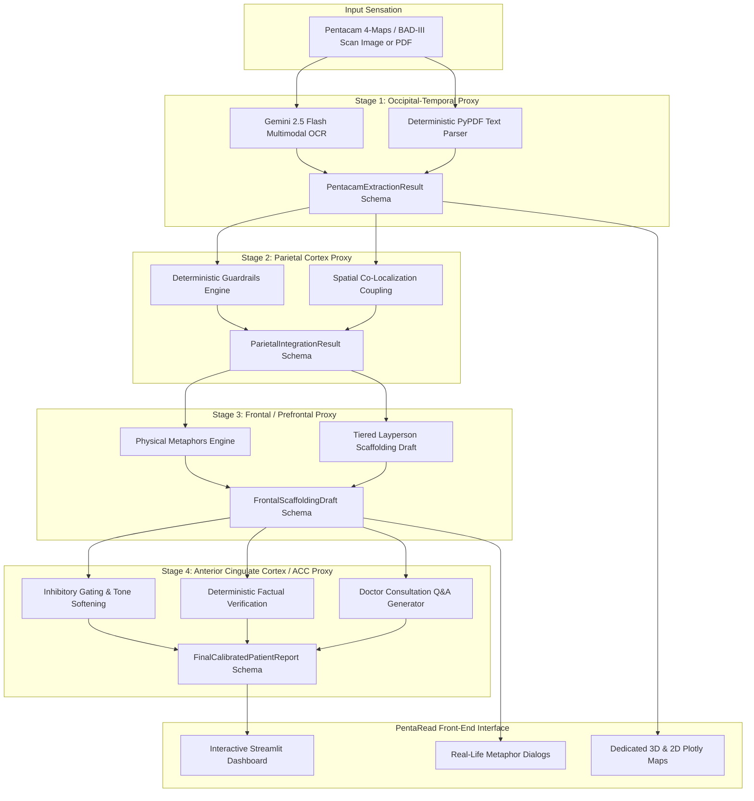

# PentaRead • Architectural & Neurocognitive Specification

This document provides a comprehensive technical and theoretical specification of the **PentaRead** Scheimpflug corneal tomography cognitive scaffolding system.

---

## 1. Executive Summary & Design Philosophy

Patients receiving corneal diagnostic reports (such as Oculus Pentacam printouts) encounter dense multi-parametric readouts featuring 4-Maps Refractive color scales, pachymetric depth profiles, and elevation metrics relative to standard reference spheres. 

Without specialized ophthalmological training, patients experience severe **prefrontal cognitive overload** and health-related anxiety. PentaRead acts as an **externalized cognitive prosthesis** modeled after human intelligence neuroscience: the **Parieto-Frontal Integration Theory (P-FIT)** (Jung & Haier, 2007).

### Key Architectural Tenets:
1. **Decoupled 4-Stage Cognitive Pipeline:** Sensation/OCR (Occipital) $\rightarrow$ Geometric Abstraction & Guardrails (Parietal) $\rightarrow$ Analogical Scaffolding (Frontal) $\rightarrow$ Cognitive Control & Safety Gating (ACC).
2. **Deterministic Boundaries First:** All clinical cutoff checks (e.g. $K_{max} > 48.5\text{ D}$, Thinnest $< 470\ \mu\text{m}$, Elevation $\ge +16\ \mu\text{m}$, $BAD\text{-}D \ge 2.60\text{ SD}$) are executed via deterministic Python rules **before** LLM generation to guarantee factual accuracy.
3. **Calibrated, Anxiety-Free Patient Output:** Diagnostic assertions (e.g., *"You have keratoconus"*) are strictly inhibited and rewritten into supportive physiological descriptors.
4. **Bespoke Solid Navy & White UI:** Clean, gradient-free visual presentation with interactive 3D surface meshes, 2D heatmaps, and `@st.dialog` modal physical metaphors.

---

## 2. Neurocognitive Foundation: P-FIT Architecture

<b>Click to view Mermaid Diagram Source</b>

---

## 3. The Four Cognitive Stages in Detail

### Stage 1: Occipital-Temporal Proxy (Feature Extraction & OCR)
* **Biological Correlate:** Brodmann Areas 17, 18, 19 (striate and peristriate visual cortices) and Area 37 (fusiform gyrus for textual recognition).
* **Implementation:** `src/pipeline/stage1_occipital.py`
* **Model:** Google Gemini (`gemini-2.5-flash`) combined with `pypdf` text stream extraction.
* **Responsibilities:**
  - Ingests raw Pentacam images (PNG, JPG, WEBP) or multi-page digital PDF exports.
  - Extracts patient name and exam date from scan headers.
  - Extracts 26 clinical indices into strictly validated Pydantic v2 schemas across 5 domains:
    1. **Keratometry:** $K_1, K_2, K_m, K_{max}$, astigmatism, axis, $Q$-value asphericity, $R_{min}$.
    2. **Pachymetry:** Central Corneal Thickness ($CCT$), Thinnest point, $(X, Y)$ displacement, $PPI_{avg/max}, ART_{max}$.
    3. **Elevation:** Anterior and posterior elevation at thinnest point relative to Best Fit Sphere (BFS) or Toric Ellipsoid (BFTE).
    4. **Belin-Ambrósio Display:** $D_f, D_b, D_t, D_a, D_p$, and Final $BAD\text{-}D$ standard deviation index.
    5. **Topometric Indices:** $ISV, IVA, KI, CKI, IHD$.

### Stage 2: Parietal Cortex Proxy (Structural Abstraction & Guardrails)
* **Biological Correlate:** Brodmann Areas 7 (superior parietal lobule), 39 (angular gyrus), and 40 (supramarginal gyrus).
* **Implementation:** `src/pipeline/stage2_parietal.py` and `src/guardrails/`
* **Responsibilities:**
  - **Deterministic Boundary Checks:** Enforces cutoff thresholds derived from the *Global Consensus on Keratoconus and Ectatic Diseases* (pure Python, zero hallucination).
  - **Spatial Co-Localization:** Computes Euclidean displacement between the thinnest pachymetric coordinate $(X_{thin}, Y_{thin})$ and keratometric apex cone $(X_{apex}, Y_{apex})$:
    $$\Delta d = \sqrt{(X_{thin} - X_{apex})^2 + (Y_{thin} - Y_{apex})^2}$$
    Coupling is flagged when $\Delta d \le 1.2\text{ mm}$ with concomitant posterior elevation protrusion.
  - **Risk Classification:** Evaluates composite risk tier (`NORMAL_CORNEA`, `SUSPECT_FORME_FRUSTE`, `MILD_ECTASIA_PATTERN`, `MODERATE_TO_ADVANCED_ECTASIA`, `POST_REFRACTIVE_ALTERATION`).

### Stage 3: Frontal / Prefrontal Proxy (Analogical Scaffolding)
* **Biological Correlate:** Brodmann Areas 9, 10 (dorsolateral prefrontal cortex), 45, and 46 (Broca's area / ventrolateral prefrontal cortex).
* **Implementation:** `src/pipeline/stage3_frontal.py`
* **Model:** Google Gemini (`gemini-2.5-flash`) with deterministic rule fallbacks.
* **Responsibilities:**
  - **Everyday Physical Metaphors:**
    - ⌚ *The Watch Glass Window:* Bridges front surface curvature, astigmatism, and $K_{max}$ steepness.
    - 📑 *The Stack of Microscopic Paper Sheets:* Bridges pachymetric thickness ($1\ \mu\text{m} = 1/1,000\text{th mm}$; normal $\approx 540\ \mu\text{m}$).
    - ⛰️ *The Mountain Contour Topography:* Bridges posterior elevation relative to standard spherical reference bodies.
  - **Optical Vision Impact:** Explains how non-uniform geometry refracts light rays, why conventional spectacles leave residual glare/ghosting, and why rigid scleral lenses or corneal cross-linking are recommended.

### Stage 4: Anterior Cingulate Cortex / ACC Proxy (Cognitive Control)
* **Biological Correlate:** Brodmann Areas 24 (ventral ACC) and 32 (dorsal ACC).
* **Implementation:** `src/pipeline/stage4_acc.py`
* **Model:** Google Gemini (`gemini-2.5-flash`) reflection pass.
* **Responsibilities:**
  - **Inhibitory Gating:** Intercepts and rewrites alarmist language (*"You have corneal degeneration"*, *"Cornea failure"*) into calibrated clinical descriptors (*"The scan demonstrates localized steepening and thinning patterns under evaluation"*).
  - **Factual Alignment Verification:** Deterministically scans generated text to ensure every cited numerical index exactly matches Stage 1 ground truth.
  - **Doctor Consultation Questions:** Generates 3–4 tailored, empowering questions with clinical rationales for the patient's next clinical visit.

---

## 4. Deterministic Clinical Cutoffs Engine

All boundary assessments are governed by empirical cutoffs in `src/guardrails/clinical_cutoffs.py`:

| Parameter | Normal Range | Borderline / Suspect | Abnormal / Pathological | Clinical Rationale |
| :--- | :--- | :--- | :--- | :--- |
| **Peak Curvature ($K_{max}$)** | $< 47.0\text{ D}$ | $47.0 - 48.5\text{ D}$ | $> 48.5\text{ D}$ | Measures focal apical steepness; $> 48.5\text{ D}$ indicates ectatic steepening. |
| **Thinnest Pachymetry** | $> 500\ \mu\text{m}$ | $470 - 500\ \mu\text{m}$ | $< 470\ \mu\text{m}$ | Global consensus marker for structural thinning. |
| **Posterior Elevation (BFS)** | $< +12.0\ \mu\text{m}$ | $+12.0 - +16.0\ \mu\text{m}$ | $\ge +16.0\ \mu\text{m}$ | Earliest indicator of ectatic bulging on the back surface. |
| **$BAD\text{-}D$ Final Index** | $< 1.60\text{ SD}$ | $1.60 - 2.60\text{ SD}$ | $\ge 2.60\text{ SD}$ | Belin-Ambrósio standard deviation deviation from healthy populations. |
| **Central Thickness ($CCT$)** | $> 520\ \mu\text{m}$ | $490 - 520\ \mu\text{m}$ | $< 490\ \mu\text{m}$ | Baseline central corneal thickness. |
| **Pachy Progression ($PPI_{max}$)**| $< 1.20$ | $1.20 - 1.45$ | $> 1.45$ | Rate of thickness decrease from periphery to center. |

---

## 5. User Interface & Visualization Architecture

### 1. View Routing (Single-Page App Pattern)
The Streamlit application (`app.py`) operates as a stateful Single-Page Application using `st.session_state.current_page`:
* `"home"`: PentaRead landing page with title, description, and three primary action buttons.
* `"upload"`: Dedicated drag-and-drop document ingestion screen.
* `"filepath"`: Dedicated local disk path entry with real-time verification.
* `"demo"`: Interactive clinical gallery of 6 authentic patient case studies.
* `"scan"`: Patient explanation guide, metrics bar, 3D/2D models, and doctor Q&A.

### 2. Deep Navy Blue & White Design System
* **Primary Canvas:** Solid Deep Navy Blue (`#0A192F`, zero gradients, zero distracting neon glow).
* **Cards & Containers:** Solid Navy Blue (`#112240`) with crisp borders (`rgba(255, 255, 255, 0.2)`).
* **Typography:** Crisp Solid White (`#FFFFFF`) for headers and key readings; off-white (`#E2E8F0`) for body prose.
* **Primary Buttons:** High-contrast solid crisp white (`#FFFFFF`) with dark navy blue text (`#0A192F`).
* **Secondary Buttons:** Solid navy (`#112240`) with white border and white text.

### 3. Metric-Coupled 3D and 2D Models (`corneal_maps.py`)
Rather than displaying a static, generic model, Plotly visualizers dynamically transform to reflect the specific metric chosen:
* **Curvature ($K_{max}$):** 3D prolate anterior surface mesh + 2D sagittal curvature heatmap with apex crosshairs.
* **Corneal Thickness:** 3D thickness profile mesh + 2D pachymetry distribution heatmap with thinnest point marker.
* **Posterior Elevation:** 3D back surface elevation mesh relative to BFS + 2D posterior elevation contour map.
* **Belin-Ambrósio ($BAD\text{-}D$):** 3D standard deviation displacement surface + speedometer gauge.
* **Healthy Reference Comparison Toggle:** Allows instantaneous side-by-side comparison between the patient's cornea and a normative healthy eye model.

---

## 6. Multi-Eye & Bilateral Comparison Engine

Corneal ectasia and keratoconus typically present asymmetrically between the two eyes. In `src/pipeline/orchestrator.py` and `app.py`:
1. When bilateral scans (both OD and OS) are detected or loaded, the system computes inter-eye deltas:
   - $\Delta K_{max} = |K_{max, OD} - K_{max, OS}|$
   - $\Delta \text{Thinnest} = |\text{Thinnest}_{OD} - \text{Thinnest}_{OS}|$
   - $\Delta \text{PosteriorElev} = |\text{Elev}_{OD} - \text{Elev}_{OS}|$
   - $\Delta BAD\text{-}D = |BAD\text{-}D_{OD} - BAD\text{-}D_{OS}|$
2. Significant asymmetry is triggered when $\Delta K_{max} \ge 1.2\text{ D}$, $\Delta \text{Thinnest} \ge 30\ \mu\text{m}$, or $\Delta \text{Elev} \ge 10\ \mu\text{m}$.
3. The UI presents a side-by-side comparative dashboard with customized questions addressing unilateral progression.

---

## 7. Developer & Evaluation Modes

To inspect the underlying cognitive engineering and audit logs:
* Append `?dev=true` to the URL: `http://localhost:8501/?dev=true`
* Activates the **P-FIT Cognitive Architecture Inspector & Guardrails Simulator** drawer:
  - Displays Stage 1 raw OCR tokens.
  - Displays Stage 2 deterministic parameter evaluations.
  - Displays Stage 4 inhibitory gating audits (suppressed assertions, softened terms, fact verification ratio).
  - Provides a live slider simulator to test empirical cutoffs in real time.
